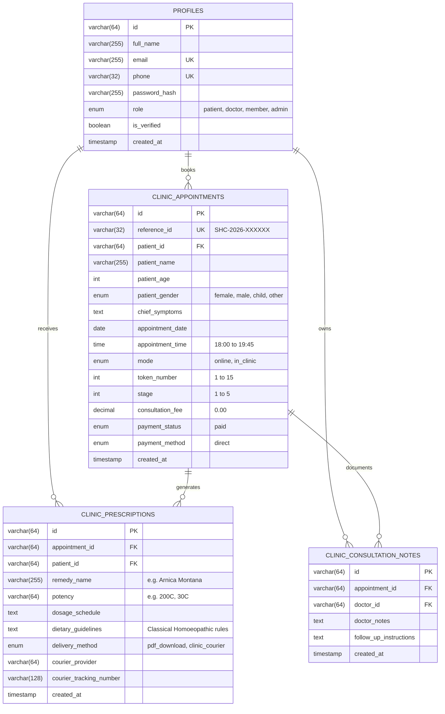

# SRI HOMOEO CARE — MYSQL WORKBENCH DATABASE GUIDE

> **Brand**: Sri Homoeo Care (*"Cure at the Core"* / *"வேரிலிருந்து முழுமையான குணம்"*)  
> **Lead Physician**: Dr. Sriindhuja C, BHMS, MSc (Psychology) · Reg. No: 5397 · Tirupattur, Tamil Nadu  
> **Database Schema**: `sri_homoeo_clinic` (MySQL 8.0+ / MariaDB)  
> **SQL Script Location**: [`sri_homoeo_clinic_schema.sql`](file:///d:/New%20Project/sri_homoeo_clinic_schema.sql)  

---

## 1. Quick Setup in MySQL Workbench (3 Steps)

### Step 1: Open MySQL Workbench
1. Launch **MySQL Workbench** on your PC.
2. Under **MySQL Connections**, click your local or remote instance (e.g., `Local instance MySQL80` at `localhost:3306`).
3. Enter your MySQL password (configured in `.env` as `Vkcs0204@`).

### Step 2: Open and Execute the SQL Script
1. In the top menu, go to **File** -> **Open SQL Script...** (or press `Ctrl + Shift + O`).
2. Navigate to and select:
   ```text
   D:\New Project\sri_homoeo_clinic_schema.sql
   ```
3. Click the **Execute** button (the yellow lightning bolt icon ⚡) or press `Ctrl + Shift + Enter`.
4. The output panel at the bottom will display green checkmarks confirming all tables, stored procedures, and initial indexes have been created.

### Step 3: Refresh Schemas
1. In the left **Navigator** pane, switch to the **Schemas** tab.
2. Right-click anywhere in the schemas list and choose **Refresh All**.
3. You will now see the `sri_homoeo_clinic` database schema with all tables ready.

---

## 2. Database Schema Overview



---

## 3. Connecting the Application to MySQL

Your application `.env` file in [`Sri/.env`](file:///d:/New%20Project/Sri/.env) connects to MySQL:

```env
DATABASE_HOST=localhost
DATABASE_PORT=3306
DATABASE_USER=root
DATABASE_PASSWORD=Vkcs0204@
DATABASE_NAME=sri_homoeo_clinic
```

The database connection is managed via `mysql2/promise` connection pooling in [`Sri/src/lib/mysql.ts`](file:///d:/New%20Project/Sri/src/lib/mysql.ts) and accessed by TanStack Start server functions in [`Sri/src/lib/clinic.functions.ts`](file:///d:/New%20Project/Sri/src/lib/clinic.functions.ts).

---

## 4. Useful Verification Queries in MySQL Workbench

### 1. View Registered Patient Profiles
```sql
USE sri_homoeo_clinic;
SELECT id, full_name, phone, email, role, is_verified, created_at 
FROM profiles 
ORDER BY created_at DESC;
```

### 2. View Active Consultation Appointments
```sql
USE sri_homoeo_clinic;
SELECT reference_id, token_number, patient_name, appointment_date, appointment_time, mode, stage
FROM clinic_appointments 
ORDER BY appointment_date DESC, token_number ASC;
```

### 3. View Digital Prescriptions & Courier Dispatches
```sql
USE sri_homoeo_clinic;
SELECT p.id, a.reference_id, a.patient_name, p.remedy_name, p.potency, p.delivery_method, p.courier_tracking_number
FROM clinic_prescriptions p
JOIN clinic_appointments a ON p.appointment_id = a.id
ORDER BY p.created_at DESC;
```
