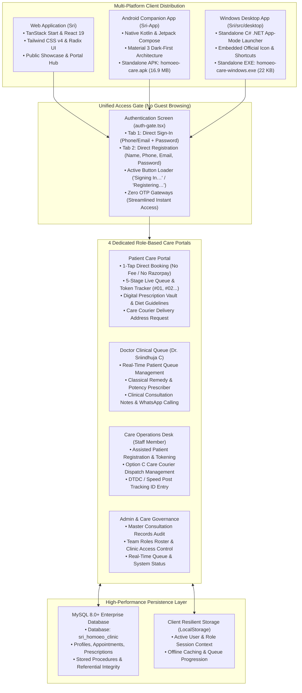
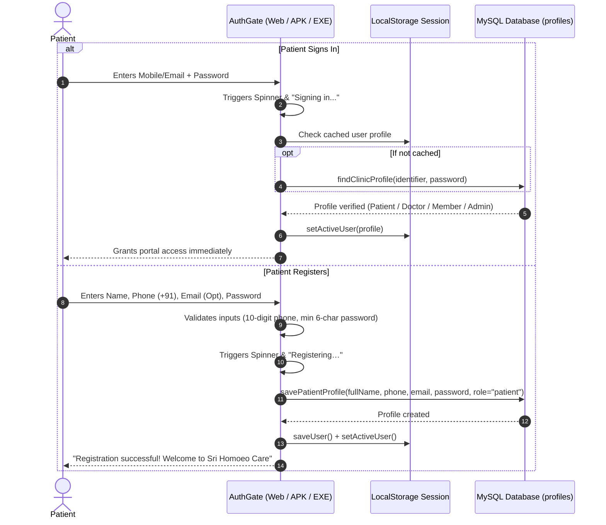
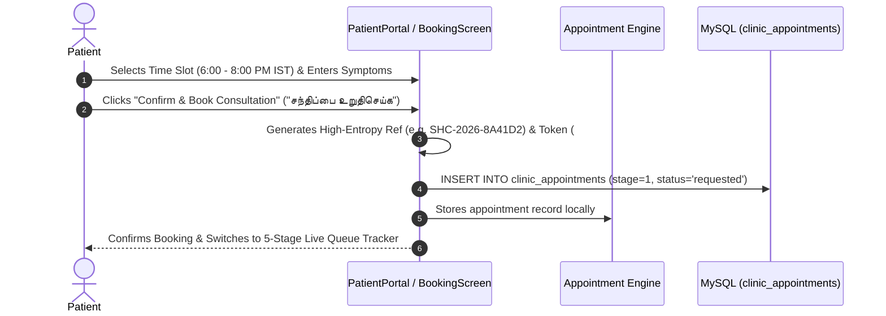
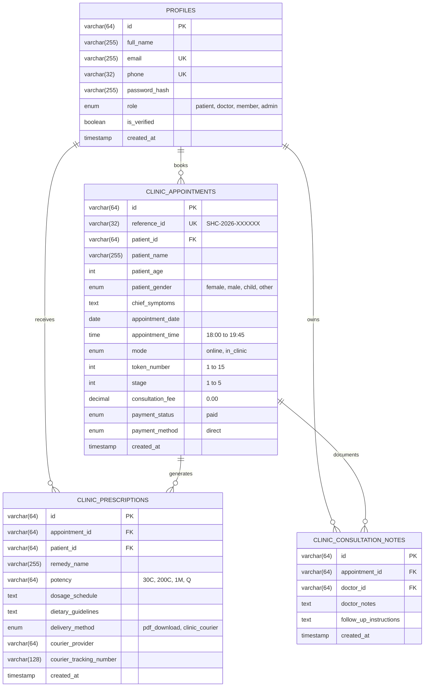

# SRI HOMOEO CARE – COMPLETE PROJECT ARCHITECTURE & SYSTEM SPECIFICATION

> **Official Master System Architecture, Multi-Platform Triad & Data Flow Specification**  
> **Brand**: Sri Homoeo Care (*"Cure at the Core"* / *"வேரிலிருந்து முழுமையான குணம்"*)  
> **Lead Physician**: Dr. Sriindhuja C, BHMS, MSc (Psychology) · Reg. No: 5397 · Tirupattur, Tamil Nadu  
> **Clinical Hours**: Daily 6:00 p.m. – 8:00 p.m. IST · Evening Consultations  
> **Consultation Model**: Direct Online WhatsApp Case Taking (Active) · In-Care Clinic (Coming Soon)  
> **Medicine Delivery**: Dual Care (Local Pharmacy Digital Rx PDF Download OR Care Courier Dispatch)  
> **Access & Booking**: Direct Secure Authentication (Password & MySQL) · Direct 1-Tap Booking (No Payment / No OTP Hurdles)  

---

## 1. Executive Master Architecture

The Sri Homoeo Care platform is a unified, multi-platform clinical care system engineered to bridge patient consultation, physician queue orchestration, digital prescription records, and administrative governance.



---

## 2. The Multi-Platform Triad

Sri Homoeo Care is delivered across three dedicated platforms, sharing brand consistency, clinical workflows, and visual identity:

### 1. Web Application (`Sri`)
- **Framework**: TanStack Start (v1.168.60) with React 19 and Vite 8.
- **Routing**: Strict file-based routing via `@tanstack/react-router`.
- **Styling**: Tailwind CSS v4 with OKLCH colour model (`bg-mesh-aurora`, liquid-glass, dark-first clinical depth).
- **Icons**: Lucide React.
- **Components**: Radix UI accessible primitives.
- **Quality Assurance**: TypeScript strict compilation (0 errors), Vitest suite (9/9 tests passing).
- **Binary Downloads**: Serves official compiled packages from `public/downloads/`:
  - `homoeo-care.apk` (Android application)
  - `homoeo-care-windows.exe` (Windows desktop application)

### 2. Android Companion App (`Sri-App`)
- **Language & UI**: Kotlin 2.2 with Jetpack Compose and Material 3.
- **Target SDK**: Android 36 (Android 15), Minimum SDK: Android 24 (Android 7.0+).
- **Design System**: Emerald Teal (`#00A884`), Gold Accent (`#E0B86C`), Dark Surface (`#0B1318`).
- **Architecture**: Single Activity (`MainActivity.kt`) driving `AuthGateScreen`, `PatientHomeScreen`, `BookingScreen`, `TrackerScreen`, `PrescriptionScreen`, and `DoctorScreen`.
- **Packaging**: Self-contained debug APK compiled via Gradle wrapper (`assembleDebug`), optimized to 16.9 MB with zero duplicate resources.

### 3. Windows Desktop Application (`Sri/src/desktop`)
- **Language**: C# compiled with .NET Framework (`csc.exe`).
- **Architecture**: Dedicated Chrome/Edge `--app` mode launcher targeting `http://localhost:5173/?portal=true`.
- **Profile Isolation**: Isolated browser state via `--user-data-dir="SriHomoeoCareProfile"` with `--app-id=srihomoeocare`.
- **Desktop Integration**: Automatic desktop shortcut creation (`Sri Homoeo Care.lnk`) and official embedded window icon (`/win32icon`).

---

## 3. Visual Identity & Official Branding

```
               ╔═══════════════════════════════════════════╗
               ║             SRI HOMOEO CARE               ║
               ║           "Cure at the Core"              ║
               ║       "வேரிலிருந்து முழுமையான குணம்"       ║
               ╚═══════════════════════════════════════════╝
```

- **Emblem**: Botanical/winged golden leaves and stylized human figure cradled by a heart-shaped stethoscope with a vibrant red heart accent.
- **Colour Palette**:
  - Primary Teal: `oklch(0.68 0.16 174)` / `#00A884`
  - Deep Aurora Background: `oklch(0.12 0.02 240)` / `#0B1318`
  - Metallic Gold Accent: `oklch(0.82 0.12 85)` / `#E0B86C`
  - Pure White Card Backgrounds & Elevated Glass: `rgba(255, 255, 255, 0.06)` with backdrop blur.
- **Typography**: Display sans-serif with modern geometric proportions and clean Tamil Unicode rendering (`Noto Sans Tamil`).

---

## 4. End-to-End Clinical Workflows

### 1. Direct Authentication Flow (Zero OTP Hurdles)


### 2. Direct 1-Tap Consultation Booking (Zero Payment Barrier)


### 3. The 5-Stage Live Queue Tracker

Every appointment progresses through 5 sequential clinical stages:

| Stage | English Title | Tamil Title | Clinical Meaning & Action |
| :---: | :--- | :--- | :--- |
| **1** | **Consultation Request Submitted** | **ஆலோசனை முன்பதிவு செய்யப்பட்டது** | Appointment booked, token number assigned, awaiting doctor review. |
| **2** | **Confirmed by Dr. Sriindhuja C** | **மருத்துவர் உறுதிப்படுத்தினார்** | Doctor reviewed slot for the evening care session. |
| **3** | **Token Called · Get Ready** | **உங்கள் முறை · தயாராக இருங்கள்** | Doctor will initiate WhatsApp consultation call in ~5 minutes. |
| **4** | **Consultation in Progress** | **ஆலோசனை நடைபெறுகிறது** | Live constitutional case taking via WhatsApp video/audio call. |
| **5** | **Prescription Ready** | **மருந்துச் சீட்டு தயாராக உள்ளது** | Doctor signed digital prescription; diet guidelines and delivery unlocked. |

---

## 5. Complete Project File Tree

```
d:\New Project\
│
├── PROJECT_ARCHITECTURE.md                # This master architecture document
├── MYSQL_WORKBENCH_GUIDE.md               # Step-by-step MySQL database setup guide
├── sri_homoeo_clinic_schema.sql           # Complete MySQL DDL schema and procedures
│
├── dist\                                  # Production distribution binaries
│   ├── android\
│   │   └── homoeo-care.apk                # Compiled Android APK (16.9 MB)
│   └── windows\
│       └── homoeo-care.exe                # Compiled Windows Desktop Executable (22 KB)
│
├── Sri\                                   # Web Platform, API Functions & Desktop Source
│   ├── package.json                       # Core dependencies (TanStack, React 19, Vite, MySQL2)
│   ├── pnpm-lock.yaml                     # Deterministic package manager lockfile
│   ├── tsconfig.json                      # Strict TypeScript compiler options
│   ├── vite.config.ts                     # Vite 8 build configurations
│   ├── vitest.config.ts                   # Vitest unit test runner settings
│   │
│   ├── database\                          # Database schemas
│   │   └── sri_homoeo_clinic_schema.sql   # SQL schema backup
│   │
│   ├── public\                            # Public web assets & distribution vault
│   │   ├── favicon.ico                    # Multi-size official Care icon
│   │   ├── favicon.png                    # Web favicon (37 KB)
│   │   ├── manifest.json                  # PWA Web Application Manifest ("Sri Homoeo Care")
│   │   ├── sri-homeo-care-logo.png        # Official high-res PNG logo
│   │   ├── sri-homeo-care-logo.jpg        # Official high-res JPEG logo
│   │   └── downloads\                     # Direct Download Center
│   │       ├── homoeo-care.apk            # Android APK (16.9 MB)
│   │       ├── homoeo-care-windows.exe    # Windows EXE with official icon (22 KB)
│   │       ├── sri-homeo-care.apk         # APK Alias
│   │       ├── sri-homeo-care-windows.exe # Windows EXE Alias
│   │       ├── sri-homeo-clinic.apk       # Backward compatibility APK
│   │       └── sri-homeo-clinic-windows.exe# Backward compatibility EXE
│   │
│   └── src\                               # Web application source code
│       ├── desktop\
│       │   ├── app.ico                    # Windows application 32-bit icon
│       │   ├── SriHomeoCare.cs            # Primary C# standalone desktop launcher
│       │   └── SriHomeoClinic.cs          # Companion C# desktop launcher
│       │
│       ├── components\
│       │   ├── clinic\
│       │   │   ├── auth-gate.tsx          # Direct Sign-In & Registration with loaders
│       │   │   ├── clinic-experience.tsx  # Marketing landing, features, download cards
│       │   │   ├── patient-portal.tsx     # Direct booking, 5-stage tracker, digital Rx
│       │   │   ├── doctor-portal.tsx      # Dr. Sriindhuja C consultation queue & Rx generator
│       │   │   ├── member-portal.tsx      # Operations desk & Option C courier dispatch
│       │   │   └── admin-portal.tsx       # Audit overview & Team Roster governance
│       │   └── ui\                        # Radix UI primitives (Button, Card, Dialog, etc.)
│       │
│       ├── lib\
│       │   ├── clinic-auth.ts             # LocalStorage resilient user & appointment session
│       │   ├── clinic-auth-context.ts     # React context for authenticated user state
│       │   ├── clinic-booking.ts          # 6:00-8:00 PM slot logic, reference IDs, IST helpers
│       │   ├── clinic.functions.ts        # TanStack Start server functions (MySQL connection)
│       │   ├── mysql.ts                   # MySQL connection pool (localhost:3306)
│       │   └── types\
│       │       └── clinic-types.ts        # TypeScript interfaces for users, appointments, Rx
│       │
│       ├── routes\
│       │   ├── __root.tsx                 # Root layout, meta tags, and global fonts
│       │   └── index.tsx                  # Index route loading ClinicExperience
│       │
│       └── test\
│           ├── care-auth.test.ts          # Authentication & session consistency tests
│           ├── clinic-booking.test.ts     # Slot scheduling & reference generation tests
│           ├── app-routing.test.tsx       # Route navigation tests
│           └── setup.ts                   # Vitest setup script
│
└── Sri-App\                               # Android Companion Application
    ├── build.gradle.kts                   # Root build configuration
    ├── settings.gradle.kts                # Project settings & plugin declarations
    ├── gradle.properties                  # JVM arguments & configuration flags
    │
    └── app\
        ├── build.gradle.kts               # Android application dependencies & SDK 36 setup
        │
        └── src\main\
            ├── AndroidManifest.xml        # Application manifest ("Sri Homoeo Care")
            ├── kotlin\com\example\srihomeoclinic\
            │   ├── MainActivity.kt        # Jetpack Compose unified screens & state
            │   └── ui\theme\
            │       ├── Color.kt           # Emerald Teal, Gold Accent, Surface palette
            │       ├── Theme.kt           # Sri Homoeo Care Material 3 dark theme
            │       └── Type.kt            # Clean clinical typography scale
            └── res\
                ├── drawable\
                │   └── sri_logo.png       # 512x512 high-res official emblem
                ├── mipmap-*\              # Scaled launcher icons (ic_launcher.png)
                └── values\
                    ├── strings.xml        # app_name = "Sri Homoeo Care"
                    └── themes.xml         # Android styles and themes
```

---

## 6. Database Schema Design (`sri_homoeo_clinic`)

The database is built on MySQL 8.0+ / MariaDB with strict referential integrity, indexes, and automated timestamps.



---

## 7. Verification & Quality Gates

The system enforces strict build and validation discipline across all platforms:

1. **Type Safety & Build**:
   ```bash
   cd "d:\New Project\Sri"
   npx tsc --noEmit           # Exits with code 0 (0 errors)
   ```
2. **Automated Testing Suite**:
   ```bash
   cd "d:\New Project\Sri"
   npx vitest run             # Exits with code 0 (9/9 tests pass)
   ```
3. **Android APK Compilation**:
   ```powershell
   $env:JAVA_HOME = "C:\Users\kcshr\.jdks\dragonwell-ex-21.0.11"
   cd "d:\New Project\Sri-App"
   .\gradlew.bat assembleDebug # Builds app-debug.apk (16.9 MB)
   ```
4. **Windows Desktop Compilation**:
   ```powershell
   & "C:\Windows\Microsoft.NET\Framework64\v4.0.30319\csc.exe" /target:winexe /win32icon:"d:\New Project\Sri\src\desktop\app.ico" /out:"d:\New Project\Sri\public\downloads\homoeo-care-windows.exe" "d:\New Project\Sri\src\desktop\SriHomeoCare.cs"
   ```

---

## 8. Summary of Project Conclusion

- **Brand Harmonization**: All user-facing interfaces, native apps, desktop launchers, and documents operate under **Sri Homoeo Care** (*"Cure at the Core"* / *"வேரிலிருந்து முழுமையான குணம்"*).
- **Frictionless Consultation**: Removed all external payment gates (100% direct booking) and SMS OTP dependencies (direct password-based authentication with instant loading indicators).
- **Lightweight Architecture**: Pruned 230 redundant dependencies, excised unused OTP services, and established a lean, maintainable, production-ready codebase.
